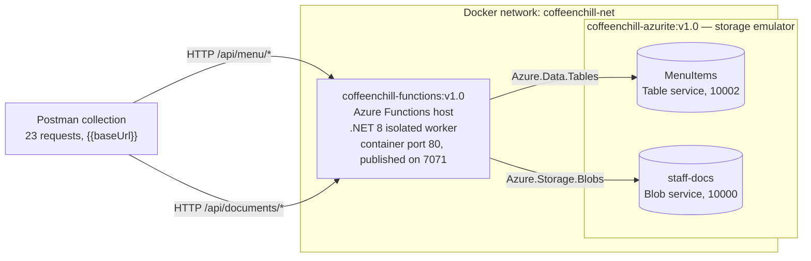

# CoffeeNChill Canteen Management System — Part 1

**Cloud Development B (CLDV6212/w) · Portfolio of Evidence · Part 1**

Azure Table Storage, centralised staff document storage and HTTP-triggered
Azure Functions, running in standalone Docker containers against the Azurite
storage emulator.

CoffeeNChill's menu was kept on a chalkboard and its operational documents in a
filing cabinet. Part 1 replaces both. Menu items are entities in an Azure Table,
so prices and availability can be changed instantly across campus, and staff
documents move into central Azure Storage reachable from any till or phone.
Eight HTTP endpoints sit in front of them, packaged as a single container image
published to Docker Hub.

---

## Table of contents

- [Team](#team)
- [Architecture](#architecture)
- [Prerequisites](#prerequisites)
- [Local setup without Docker](#local-setup-without-docker)
- [Running the containers](#running-the-containers)
- [Docker Hub images](#docker-hub-images)
- [API endpoints](#api-endpoints)
- [Testing](#testing)
- [Repository layout](#repository-layout)
- [Commit history](#commit-history)
- [Video demonstration](#video-demonstration)
- [Use of AI tools](#use-of-ai-tools)
- [Code attribution and references](#code-attribution-and-references)

---

## Team

| Member | Student number | GitHub | Responsibility |
| --- | --- | --- | --- |
| `<NAME>` | `<STUDENT NUMBER>` | `<GITHUB USERNAME>` | Menu management: `MenuItems` table schema, the five HTTP CRUD functions, category filtering, model validation and error handling. |
| `<NAME>` | `<STUDENT NUMBER>` | `<GITHUB USERNAME>` | Staff documents: the `staff-docs` container, streamed upload, list and download functions, MIME and size guards, service registration in `Program.cs`. |
| `<NAME>` | `<STUDENT NUMBER>` | `<GITHUB USERNAME>` | Containerisation and testing: multi-stage Dockerfile, container networking, image publishing, the Postman collection, the API contract and this documentation. |

---

## Architecture

The system runs as two containers on one user-defined Docker network. The
Functions host is stateless; all state lives in Azurite, which emulates the
Azure Storage account that would sit in the cloud in production.



**Design decisions.**

- A single Functions host serves all eight endpoints on one port, built on the
  .NET 8 isolated worker model (Microsoft, 2026c). `MenuFunctions` owns the
  `/api/menu` prefix and `DocumentFunctions` owns `/api/documents`, so one
  container exposes the whole API and a single base URL reaches everything.
- Both feature slices resolve their storage client from
  `IConfiguration["AzureWebJobsStorage"]` rather than a hardcoded connection
  string. The same compiled image therefore runs against local Azurite during
  development and against the Azurite container under Docker, with only an
  environment variable changing.
- HTTP concerns and storage concerns are separated. The functions deserialise,
  validate and map results to status codes; `MenuTableService` and
  `DocumentStorageService` are the only types that reference `TableClient` or
  `BlobContainerClient`.
- The menu category is the `PartitionKey` and the SKU is the `RowKey`, accessed
  through the Azure Tables client library (Microsoft, 2026a). This makes the
  category filter a partition scan rather than a table scan, and Microsoft's
  design guidance ranks queries specifying both keys as the most efficient the
  service offers (Microsoft, 2026f).
- Every failure from every endpoint returns the same `{ "errors": [ ... ] }`
  object, so clients need one error-handling path rather than eight.

The diagram above is a Mermaid block, which GitHub renders natively in Markdown
(GitHub, 2026), keeping it in version control as text rather than as an image.

Full request and response shapes, status codes and the reasoning behind them are
in [`docs/api-contract.md`](docs/api-contract.md).

### Storage backing for staff documents

The assignment brief specifies an Azure File Share for staff documents and
Azurite for local emulation. These two requirements are incompatible: Azurite
"supports only the Blob, Queue, and Table storage services. It doesn't support
Azure Files or Azure Data Lake Storage Gen2" (Microsoft, 2026g). There is no
file-service port in the emulator and no `Azure.Storage.Files.Shares` call that
succeeds against it.

`staff-docs` is therefore implemented as a **blob container**, reached with
`Azure.Storage.Blobs`. The endpoint routes, status codes, streamed transfer,
MIME allow-list, size guard and file metadata are unchanged by this. The
alternative — pointing `Azure.Storage.Files.Shares` at a live Azure Storage
account — requires a subscription and prevents the stack from running offline.

---

## Prerequisites

| Tool | Version | Needed for |
| --- | --- | --- |
| Docker Desktop | 4.x or later | Running Azurite and the Functions container |
| .NET SDK | 8.0 | Local development |
| Azure Functions Core Tools | v4 | Running the host locally with `func start` |
| Postman | 11.x or later | Running the test collection |

Azure Storage Explorer is optional and shows the contents of the `MenuItems`
table and the `staff-docs` container directly.

---

## Local setup without Docker

**1. Clone the repository.**

```bash
git clone https://github.com/<GITHUB USERNAME>/<REPO NAME>.git
cd <REPO NAME>
```

**2. Start Azurite.**

```bash
docker run -d --name azurite \
  -p 10000:10000 -p 10001:10001 -p 10002:10002 \
  mcr.microsoft.com/azure-storage/azurite
```

Blob on 10000, queue on 10001, table on 10002.

**3. Create `local.settings.json`** in `CoffeeNChill.Functions/`. It is excluded
by `.gitignore` because it is per-machine configuration.

```json
{
  "IsEncrypted": false,
  "Values": {
    "AzureWebJobsStorage": "UseDevelopmentStorage=true",
    "FUNCTIONS_WORKER_RUNTIME": "dotnet-isolated"
  }
}
```

`UseDevelopmentStorage=true` is the documented shortcut for the well-known
Azurite development account on `127.0.0.1` (Microsoft, 2026d). It applies to
local development only; see [Running the containers](#running-the-containers).

**4. Restore and start the Functions host.**

```bash
cd CoffeeNChill.Functions
dotnet restore
func start
```

All eight routes are listed at startup.

**5. Seed the menu.**

```bash
cd ..
bash docs/seed-menu.sh
```

The script posts each item in `docs/seed-menu.json` to `/api/menu`. It populates
Hot Drinks, Cold Drinks and Pastries, and leaves Sandwiches empty — see
[Testing](#testing) for why.

---

## Running the containers

Part 1 uses no Docker Compose; each container is started individually. The flags
below are `--network` to join the user-defined network, `-p` to publish a port,
`-e` to set an environment variable and `-d` to detach (Docker, 2026).

**1. Create the network.** Both containers must be on it for the Functions host
to resolve Azurite by name.

```bash
docker network create coffeenchill-net
```

**2. Start Azurite.**

```bash
docker run -d --name azurite --network coffeenchill-net \
  -p 10000:10000 -p 10001:10001 -p 10002:10002 \
  <DOCKERHUB USERNAME>/coffeenchill-azurite:v1.0
```

**3. Start the Functions container.**

```bash
docker run -d --name functions --network coffeenchill-net \
  -p 7071:80 \
  -e AzureWebJobsStorage="DefaultEndpointsProtocol=http;AccountName=devstoreaccount1;AccountKey=Eby8vdM02xNOcqFlqUwJPLlmEtlCDXJ1OUzFT50uSRZ6IFsuFq2UVErCz4I6tq/K1SZFPTOtr/KBHBeksoGMGw==;BlobEndpoint=http://azurite:10000/devstoreaccount1;QueueEndpoint=http://azurite:10001/devstoreaccount1;TableEndpoint=http://azurite:10002/devstoreaccount1;" \
  <DOCKERHUB USERNAME>/coffeenchill-functions:v1.0
```

**4. Confirm both are running.**

```bash
docker ps
curl http://localhost:7071/api/menu
```

### Why the connection string is expanded

`UseDevelopmentStorage=true` resolves to `127.0.0.1` (Microsoft, 2026d). Inside a
container that address refers to the container itself, where no storage service
is listening, so the shortcut that works during local development fails once the
application is containerised.

The expanded form above substitutes the Azurite **container name** for the
loopback address, which resolves because both containers share the
`coffeenchill-net` network. The account name and key are Azurite's fixed,
publicly documented development credentials.

This works because neither `MenuTableService` nor `DocumentStorageService`
hardcodes a connection string; both read `AzureWebJobsStorage` from
`IConfiguration`, so the same image runs unchanged in both environments.

### Stopping the stack

```bash
docker rm -f functions azurite
docker network rm coffeenchill-net
```

---

## Docker Hub images

Both images are public and tagged with a semantic version.

| Image | Tag | Link |
| --- | --- | --- |
| `<DOCKERHUB USERNAME>/coffeenchill-functions` | `v1.0` | `https://hub.docker.com/r/<DOCKERHUB USERNAME>/coffeenchill-functions` |
| `<DOCKERHUB USERNAME>/coffeenchill-azurite` | `v1.0` | `https://hub.docker.com/r/<DOCKERHUB USERNAME>/coffeenchill-azurite` |

Docker repository names must be lowercase, so the Azurite image is published as
`coffeenchill-azurite`.

Build and publish:

```bash
docker buildx build --platform linux/amd64 \
  -t <DOCKERHUB USERNAME>/coffeenchill-functions:v1.0 \
  --push ./CoffeeNChill.Functions
```

The platform is pinned to `linux/amd64` so the published image runs on x86_64
hosts regardless of the architecture it was built on.

---

## API endpoints

| Method | Route | Description | Success | Failure |
| --- | --- | --- | --- | --- |
| POST | `/api/menu` | Create a menu item | 201 | 400, 409 |
| GET | `/api/menu` | List all menu items | 200 | — |
| GET | `/api/menu/category/{category}` | Filter by category partition | 200 | 400 |
| PUT | `/api/menu/{category}/{id}` | Update price or availability | 200 | 400, 404 |
| DELETE | `/api/menu/{category}/{id}` | Remove a menu item | 204 | 404 |
| POST | `/api/documents/upload` | Upload a staff document | 201 | 400 |
| GET | `/api/documents` | List staff documents | 200 | — |
| GET | `/api/documents/download/{fileName}` | Download a staff document | 200 | 404 |

Categories are `Hot Drinks`, `Cold Drinks`, `Pastries` and `Sandwiches`. A
category containing a space is percent-encoded in the route: `Hot%20Drinks`.

An **empty** category returns `200` with `[]`; an **unknown** category returns
`400`. 404 indicates that the server found no current representation of the
target resource, while 400 covers a request the server cannot process because of
a client error (Fielding, Nottingham and Reschke, 2022). An empty category is a
valid resource that happens to contain nothing.

---

## Testing

`docs/CoffeeNChill.postman_collection.json` contains **23 requests across three
folders**, carrying 84 assertions in total. Every request resolves its address
from the `{{baseUrl}}` environment variable; no URL is hardcoded. Requests that
need an identifier read it from a collection variable set by an earlier
response.

| Folder | Requests | Coverage |
| --- | --- | --- |
| Menu | 10 | All five menu endpoints, plus duplicate SKU, negative price and unknown category |
| Staff Documents | 7 | Upload, list and download, plus MIME, size, missing-file and no-file-attached guards |
| Errors & Edge Cases | 6 | Smoke test, unknown route, malformed JSON, empty category, encoded space, empty body |

### Running the collection

1. Import `docs/CoffeeNChill.postman_collection.json`.
2. Import `docs/CoffeeNChill-Local.postman_environment.json` and select it in the
   environment dropdown. Without a selected environment `{{baseUrl}}` resolves to
   nothing and every request fails.
3. Re-attach the three upload files. Postman stores an attached file as a path on
   the machine that attached it, so attachments are not carried inside an
   exported collection. In the Staff Documents folder, open each upload request,
   go to **Body → form-data**, and select the file from `docs/test-files/`:
   - *Upload staff document* → `barista-recipe-sheet.pdf`
   - *Upload — disallowed type* → `not-allowed.exe`
   - *Upload — oversized file* → `oversized.pdf`
4. Open the Collection Runner, select the collection, and run.

The oversized fixture is 6 MB and is generated rather than committed:

```bash
head -c 6291456 /dev/zero | tr '\0' '0' > docs/test-files/oversized.pdf
```

From the command line:

```bash
newman run docs/CoffeeNChill.postman_collection.json \
  -e docs/CoffeeNChill-Local.postman_environment.json
```

### Repeatability

The collection can be run any number of times against the same container without
resetting state. *Create menu item* deletes `Hot Drinks/COF-001` in a pre-request
script before creating it, and *Delete menu item* removes the same row at the end
of the Menu folder using the identifiers saved in collection variables.

Two pieces of test data are reserved for this reason. `Hot Drinks/COF-001` is
created and deleted by every run, so `seed-menu.json` does not contain it.
`Sandwiches` is left empty by the seed data so that the empty-category case has
something to assert against.

### Diagnosing a failure

*Errors & Edge Cases → Smoke test* is a plain `GET /api/menu`. If it fails, the
storage connection or the container is at fault rather than the endpoint under
test.

---

## Repository layout

```text
.
├── CoffeeNChill.Functions/
│   ├── Entities/            MenuItemEntity
│   ├── Dtos/                Request and response contracts, shared error shape
│   ├── Validation/          DataAnnotations constraints and the validator
│   ├── Services/            MenuTableService, DocumentStorageService
│   ├── Functions/           MenuFunctions, DocumentFunctions
│   ├── Dockerfile
│   ├── Program.cs
│   └── host.json
├── docs/
│   ├── api-contract.md                              Endpoint specification
│   ├── CoffeeNChill.postman_collection.json         23 requests, 84 assertions
│   ├── CoffeeNChill-Local.postman_environment.json  baseUrl
│   ├── seed-menu.json                               Sample menu data
│   ├── seed-menu.sh                                 Seeding script
│   └── test-files/                                  Upload fixtures
├── global.json                                      Pins the SDK to 8.0
└── README.md
```

`bin/`, `obj/`, `local.settings.json` and the generated oversized fixture are
excluded by `.gitignore`. No archive files are committed.

---

## Commit history

```bash
git shortlog -sn --no-merges
```

```text
<PASTE THE OUTPUT OF THE COMMAND ABOVE>
```

Commit activity over time:

```bash
git log --pretty=format:'%ad  %an  %s' --date=short --no-merges
```

---

## Video demonstration

Unlisted YouTube link: `<PASTE THE UNLISTED YOUTUBE URL>`

The recording shows the containers being started with `docker run`, the Postman
collection executing in the Collection Runner, and each member explaining the
code they wrote.

---

## Use of AI tools

`<Each member states which tools were used and for what, or that none were used.>`

| Member | Tool | Used for |
| --- | --- | --- |
| `<NAME>` | | |
| `<NAME>` | | |
| `<NAME>` | | |

---

## Code attribution and references

Adapted code carries an attribution block directly above it in the source file
where it is used. Every source named in one of those blocks appears below, and
every source below is cited in this README, in
[`docs/api-contract.md`](docs/api-contract.md), or in an attribution block inside
the Postman collection's test scripts.

Referencing style: IIE Harvard.

Azure SDK for .NET, 2026. *TableClient.cs*. [Online]
Available at: <https://github.com/Azure/azure-sdk-for-net/blob/main/sdk/tables/Azure.Data.Tables/src/TableClient.cs>
[Accessed 13 September 2026].

Chai, 2026. *Expect / Should*. Chai Assertion Library. [Online]
Available at: <https://www.chaijs.com/api/bdd/>
[Accessed 13 September 2026].

Docker, 2026. *docker container run*. Docker Docs. [Online]
Available at: <https://docs.docker.com/reference/cli/docker/container/run/>
[Accessed 13 September 2026].

Fielding, R., Nottingham, M. and Reschke, J., 2022. *RFC 9110: HTTP Semantics*. [Online]
Available at: <https://www.rfc-editor.org/rfc/rfc9110.html>
[Accessed 13 September 2026].

GitHub, 2026. *Creating diagrams*. GitHub Docs. [Online]
Available at: <https://docs.github.com/en/get-started/writing-on-github/working-with-advanced-formatting/creating-diagrams>
[Accessed 13 September 2026].

Microsoft, 2026a. *Azure Tables client library for .NET*. [Online]
Available at: <https://learn.microsoft.com/en-us/dotnet/api/overview/azure/data.tables-readme>
[Accessed 13 September 2026].

Microsoft, 2026b. *Azure Functions HTTP trigger*. [Online]
Available at: <https://learn.microsoft.com/en-us/azure/azure-functions/functions-bindings-http-webhook-trigger>
[Accessed 13 September 2026].

Microsoft, 2026c. *Guide for running C# Azure Functions in the isolated worker model*. [Online]
Available at: <https://learn.microsoft.com/en-us/azure/azure-functions/dotnet-isolated-process-guide>
[Accessed 13 September 2026].

Microsoft, 2026d. *Connect to Azurite with SDKs and tools*. [Online]
Available at: <https://learn.microsoft.com/en-us/azure/storage/common/storage-connect-azurite>
[Accessed 13 September 2026].

Microsoft, 2026e. *Understanding the Table service data model*. [Online]
Available at: <https://learn.microsoft.com/en-us/rest/api/storageservices/understanding-the-table-service-data-model>
[Accessed 13 September 2026].

Microsoft, 2026f. *Guidelines for table design*. [Online]
Available at: <https://learn.microsoft.com/en-us/azure/storage/tables/table-storage-design-guidelines>
[Accessed 13 September 2026].

Microsoft, 2026g. *Use the Azurite emulator for local Azure Storage development*. [Online]
Available at: <https://learn.microsoft.com/en-us/azure/storage/common/storage-use-azurite>
[Accessed 13 September 2026].

Postman, 2026a. *Test examples in Postman*. [Online]
Available at: <https://learning.postman.com/docs/tests-and-scripts/write-scripts/test-examples/>
[Accessed 13 September 2026].

Postman, 2026b. *Store and reuse values using variables*. [Online]
Available at: <https://learning.postman.com/docs/sending-requests/variables/variables/>
[Accessed 13 September 2026].

Postman, 2026c. *Use scripts to send requests in Postman*. [Online]
Available at: <https://learning.postman.com/docs/tests-and-scripts/write-scripts/postman-sandbox-reference/pm-send-request/>
[Accessed 13 September 2026].

Postman, 2026d. *Postman Sandbox API reference*. [Online]
Available at: <https://learning.postman.com/docs/tests-and-scripts/write-scripts/postman-sandbox-api-reference/>
[Accessed 13 September 2026].
